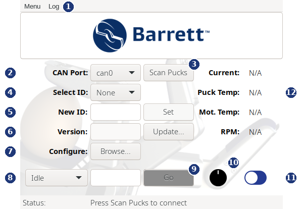

The Puck Utility App updates the firmware of P4 Pucks, loads their
configuration, calibrates them and runs simple motion tests. This guide covers
the main window, the menus and the usual order of work. For help with common
problems, see [Troubleshooting](#troubleshooting).

## Main window

1. **Menu.** Scanning, firmware updates, calibration and other tools; see
   [Menus](#menus).
2. **CAN Port.** Chooses the CAN adapter. *Nothing is opened until you press
   Scan Pucks.*
3. **Scan Pucks.** Opens the port, finds every Puck on the bus and selects the
   lowest ID. *The app does not scan at startup: press Scan Pucks once the
   Pucks are powered and connected.*
4. **Select ID.** Chooses the active Puck. Everything else in the window acts
   on the active Puck.
5. **New ID.** Enter a new ID (1-127) and press **Set**. *Every Puck on a bus
   needs its own ID. The Puck's PDO settings are moved to the new ID too.*
6. **Version / Update...** Shows the firmware version. **Update...** flashes a
   firmware file (`.ebin`) to the active Puck. *After an update the Puck must
   be configured again before it can be calibrated or driven.*
7. **Configure / Browse...** Loads a configuration file (`.csv`) into the
   active Puck and saves it. *The app refuses a file made for a different Puck
   model (product code mismatch).*
8. **Mode.** Idle, Trq (mNm), Vel (RPM), Pos (deg) or Homing. Enter the value
   in the box beside it.
9. **Go.** Sends the value and enables the Puck. *In position mode, each Go
   adds the value to the current target. Choose Idle to stop.*
10. **Position dial.** Shows the motor shaft angle while the ADC Monitor is
    on. *It shows the motor shaft, not the gearhead output.*
11. **ADC Monitor ON/OFF.** Turns the live readings on or off.
12. **Readings.** While the ADC Monitor is on: motor current, Puck
    temperature, motor temperature and output speed (rpm).

You can also drag a file onto the window: a `.ebin` is flashed, a `.csv` is
loaded as a configuration, and an `.ini` runs a system configuration.

## Getting a Puck ready

1. Connect the CAN adapter and power the Pucks. Choose the **CAN Port** and
   press **Scan Pucks**.
2. If the firmware needs updating, press **Update...** and choose the `.ebin`
   file. For several Pucks, use **Menu > Update All Pucks (Firmware)**.
3. Press **Configure: Browse...** and choose the actuator's configuration
   `.csv`.
4. Run **Menu > Actuator Calibration > Active Puck** (or **All Pucks**). The
   motor turns, so the output must be free to move. Each step is saved to the
   Puck as it passes.
5. Choose a mode, enter a value and press **Go** to check the Puck. Choose
   **Idle** to stop.

## Menus

### Menu

| Item | What it does |
|---|---|
| Scan Pucks (Ctrl+S) | The same as the Scan Pucks button. |
| Update All Pucks (Firmware) (Ctrl+U) | Flashes one firmware file to every Puck on the bus, one after another. |
| Upload System Config | Runs an `.ini` file that names, for each Puck ID, the firmware and configuration it should have. Pucks not on the bus are skipped. |
| ON/OFF ADC Monitor (Ctrl+P) | The same as the ON/OFF switch. |
| Actuator Calibration > Active Puck (Ctrl+C) | Runs every calibration step the Puck's firmware supports, on the active Puck. |
| Actuator Calibration > All Pucks | The same, on every Puck on the bus. |
| Actuator Calibration Steps | Runs one calibration step on its own. Only the steps the Puck's firmware supports are listed, numbered in the order a full calibration runs them. |
| Encoder Error Compensation > ON / OFF | Turns the encoder runout correction on or off, and saves the setting. Shown only when the firmware supports it. |
| Set User Direction... | Turn the output by hand, more than 1/8 turn, in the direction you want to be positive; the Puck's direction is set to match and saved. |
| Help | Opens this guide. |
| Exit | Closes the app. |

*Tune Gains... and Save to CSV... are not available yet.*

### Log

**Open Log...** shows the session log, with the details behind any error.

## Troubleshooting

### No CAN device found!

The CAN adapter could not be opened.

- Check that the adapter is plugged in and its driver is installed.
- Check that the CAN bus is terminated.
- A CANable adapter in DFU (bootloader) mode is reported as such: flash its
  firmware with `puckutility flash-canable`.

### No Pucks Found!

The CAN adapter opened, but no Puck answered.

- Check the Pucks' power and the CAN cables.
- Check that the Puck's 5 V and 3.3 V LEDs are on.
- Press **Scan Pucks** again. If it still fails, unplug the CAN adapter and
  plug it back in.

### Scan Error

A Puck answered but could not be read. The usual cause is two Pucks with the
same ID: connect them one at a time and give each its own ID with **New ID**.

### Configuration file failed to upload

The configuration was not loaded, and the Puck will not calibrate or drive
until one is.

- Check that the file is the right one for this Puck and firmware.
- Open **Log > Open Log...** for the details.

### Product Code Mismatch

The `.csv` is for a different Puck model. Choose the file for this model.

### Drive blocked -- calibration looks bad

The Puck's current-sense calibration is missing or wrong, and driving it
could make it oscillate. Run **Menu > Actuator Calibration > Active Puck**.

### Motor does not turn

- Turn on the ADC Monitor and check the readings.
- Check that the right configuration is loaded, then run the actuator
  calibration.
- Check the bus voltage.

### Other messages

| Message | Meaning |
|---|---|
| Configuration is required after a firmware update. | Load the configuration `.csv` (Yes opens the file browser). |
| ID already in use! | Another Puck on the bus has that ID. |
| Invalid CAN ID (must be 1-127)! | Enter an ID from 1 to 127. |
| No active node! | Scan, and select a Puck first. |
| No input value! | Enter a value before pressing Go. |
| No mode selected! | Choose a mode before pressing Go. |
| Firmware Too Old | The feature needs newer firmware: update the Puck. |
| CAN interface unavailable | Another program is using the CAN adapter. Close it, then scan again. |

If you see a problem that is not listed here, contact Barrett support.

## Command line

Run `puckutility --help` for the commands: `scan`, `flash`, `config load`,
`calibrate`, `set-id`, `system-config` and more. With no command, it starts the
app.

## Contact us

Barrett Technology: (617) 252-9000, [barrett.com](https://barrett.com),
<support@barrett.com>.
